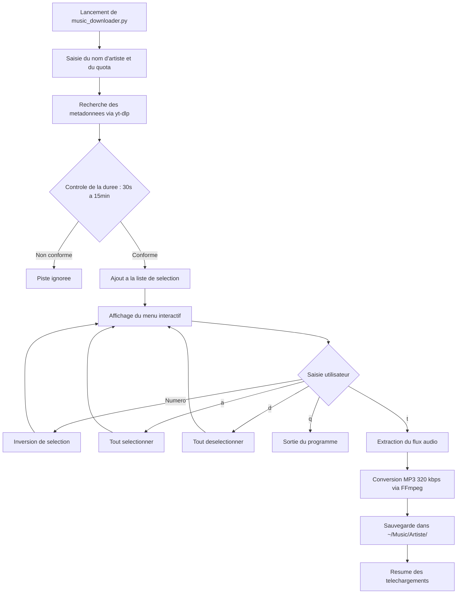
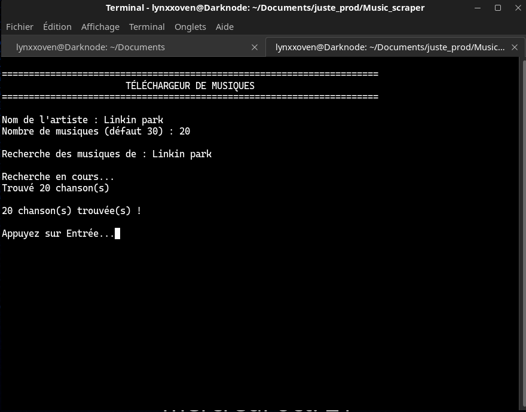
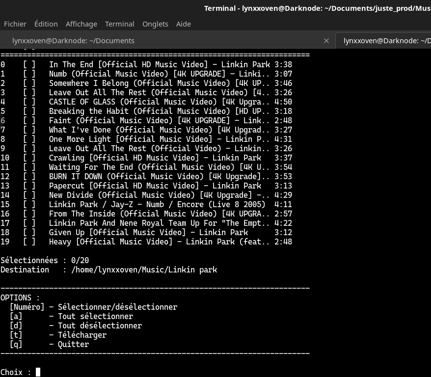
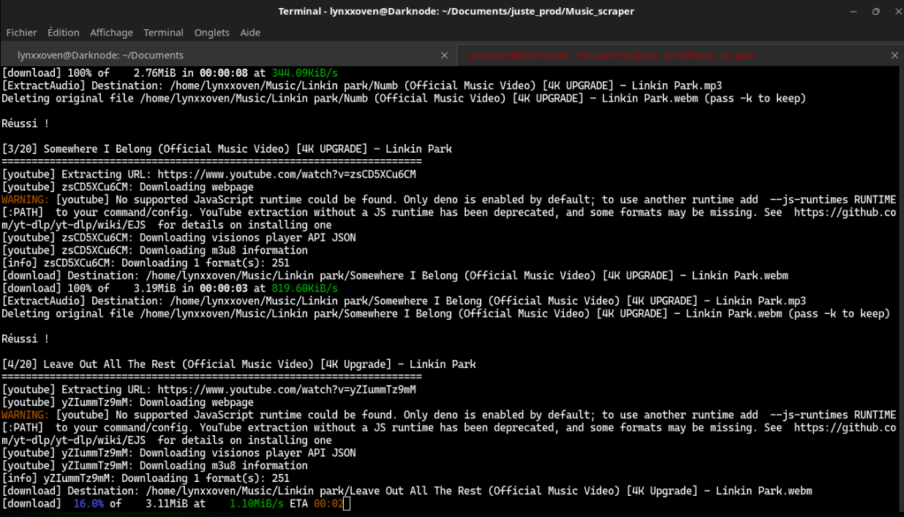
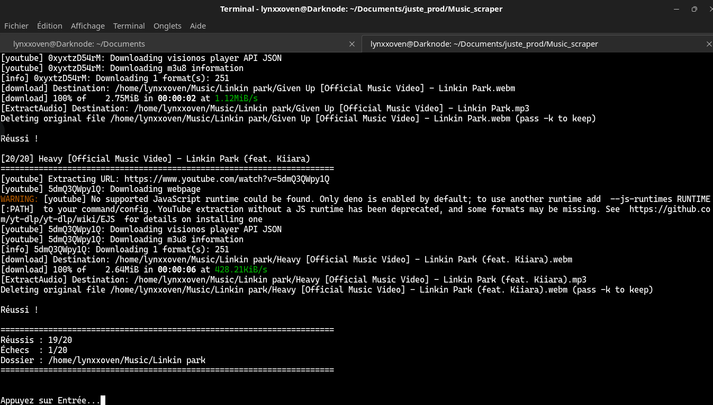

# Music Scraper - Telechargeur de musiques par artiste

Music Scraper est un utilitaire en ligne de commande (CLI) developpe en Python permettant d'automatiser la recherche de chansons d'un artiste donné, d'offrir une interface de selection interactive dans le terminal, et de telecharger les pistes choisies sous forme de fichiers audio MP3 a 320 kbps classes automatiquement dans un repertoire dedie.

---

## Sommaire

- [Description generale](#description-generale)
- [Fonctionnalites principales](#fonctionnalites-principales)
- [Analyse detaillee du code](#analyse-detaillee-du-code)
- [Architecture et flux d'execution](#architecture-et-flux-dexecution)
- [Installation et configuration](#installation-et-configuration)
- [Guide d'utilisation](#guide-dutilisation)
  - [Etape 1 : Saisie de l'artiste et recherche](#etape-1--saisie-de-lartiste-et-recherche)
  - [Etape 2 : Menu interactif et selection des morceaux](#etape-2--menu-interactif-et-selection-des-morceaux)
  - [Etape 3 : Telechargement et conversion audio MP3](#etape-3--telechargement-et-conversion-audio-mp3)
  - [Etape 4 : Consultation des fichiers generes](#etape-4--consultation-des-fichiers-generes)
- [Options et raccourcis](#options-et-raccourcis)
- [Arborescence du projet](#arborescence-du-projet)
- [Informations complementaires](#informations-complementaires)

---

## Description generale

Le script interagit avec YouTube via le moteur `yt-dlp` pour extraire des flux audio sans necessiter de cle API externe. Il convertit automatiquement le flux audio obtenu en format MP3 a un debit binaire fixe de 320 kbps a l'aide de FFmpeg, garantissant une qualite d'ecoute superieure.

---

## Fonctionnalites principales

- Recherche par mot-cle ou nom d'artiste sans configuration complexe d'API.
- Filtrage base sur la duree des pistes (entre 30 secondes et 15 minutes) afin d'eliminer les jingles courts ou les longs enregistrements d'albums complets.
- Normalisation du nom d'artiste : suppression des suffixes automatiques tels que ` - Topic` ou `VEVO` pour creer un dossier de destination propre.
- Interface en mode console interactive avec selection / deselection par index ou par lot.
- Post-traitement audio FFmpeg automatique convertissant les pistes en format MP3 320 kbps.
- Rangement automatique dans le repertoire utilisateur standard (`~/Music/<NomArtiste>/`).

---

## Analyse detaillee du code

Le script principal `music_downloader.py` est organise autour d'une classe unique, `MusicDownloader`, facilitant la maintenance et la lisibilite.

### 1. Initialisation (`__init__`)
- `self.selected_tracks` : stocke un ensemble (`set`) contenant les identifiants numeriques des pistes selectionnees par l'utilisateur.
- `self.base_music_dir` : pointe vers le repertoire `~/Music` de l'utilisateur et le cree automatiquement s'il n'existe pas.

### 2. Recherche et filtrage (`search_artist_songs`)
- Utilise l'extracteur `ytsearch{limit}:{artist_name}` de `yt-dlp` avec l'option `download=False` pour limiter la charge reseau aux seules metadonnees.
- Filtre chaque entree selon sa duree (`30 < duration < 900`).
- Construit une liste de dictionnaires comportant l'index, le titre, l'auteur, la duree formatee en minutes:secondes et l'URL source.
- Detecte et epure le nom de l'artiste (`artist_real`) pour nommer correctement le repertoire de stockage.

### 3. Affichage tabulaire (`display_songs`)
- Met en forme les titres sous forme d'un tableau texte aligne avec colonnes : index, statut de coche (`[X]` ou `[ ]`), titre tronque et duree.

### 4. Menu interactif (`menu`)
- Boucle principale d'interaction basee sur l'effacement de l'ecran (`clear`).
- Permet de selectionner ou deselectionner une piste a la fois (`toggle_selection`), de tout selectionner (`select_all`), de tout deselectionner (`deselect_all`), de declencher le telechargement ou de quitter.

### 5. Telechargement et conversion (`download_songs`)
- Configure les parametres `yt-dlp` avec le postprocesseur `FFmpegExtractAudio`.
- Specifie le format `bestaudio/best`, le codec cible `mp3` et le debit `320 kbps`.
- Enregistre les fichiers directement dans `~/Music/<NomArtiste>/<Titre>.mp3`.
- Affiche un bilan final du nombre de succes et d'echecs.

---

## Architecture et flux d'execution



---

## Installation et configuration

### Prerequis

- Python version 3.9 ou superieure
- Git

### 1. Clonage du depot

```bash
cd ~/Documents/juste_prod
git clone https://github.com/LynxxoV9/Music_scraper.git
cd Music_scraper
```

### 2. Creation de l'environnement virtuel

Creer l'environnement virtuel nomme `youenv` :

```bash
python3 -m venv youenv
```

Activer l'environnement virtuel :

```bash
source youenv/bin/activate
```

### 3. Installation des dependances

Installer les packages requis listes dans `requirements.txt` :

```bash
pip install -r requirements.txt
```

Le fichier `requirements.txt` comprend :
- `yt-dlp` : moteur d'extraction de donnees et flux YouTube.
- `static-ffmpeg` : fournit les binaires FFmpeg et FFprobe de maniere portable, eliminant tout besoin d'installation systeme sous droits root.

---

## Guide d'utilisation

### Etape 1 : Saisie de l'artiste et recherche

Lancez le programme depuis le terminal avec l'environnement virtuel actif :

```bash
python3 music_downloader.py
```

Renseignez le nom de l'artiste recherche ainsi que le nombre de morceaux voulus (valeur par defaut : 30). Le script lance alors la recherche.



---

### Etape 2 : Menu interactif et selection des morceaux

La liste des morceaux trouves s'affiche avec leurs durees respectives. Vous pouvez basculer l'etat d'une chanson en indiquant son numero, taper `a` pour tout selectionner ou `d` pour tout vider.



---

### Etape 3 : Telechargement et conversion audio MP3

Appuyez sur `t` pour lancer le processus. Le script telecharge le flux source et l'encode automatiquement au format MP3 320 kbps avec suppression des fichiers temporaires.



---

### Etape 4 : Consultation des fichiers generes

A l'issue des operations, un bilan indique le total des morceaux recuperes. Les fichiers MP3 sont directement accessibles dans votre dossier personnel : `~/Music/<NomArtiste>/`.



---

## Options et raccourcis

| Commande | Action |
|:---:|:---|
| `<numero>` | Bascule l'etat coche/decoche du morceau designe par cet index |
| `a` | Coche l'ensemble des titres presentes |
| `d` | Decoche l'ensemble des titres |
| `t` | Declenche le telechargement et l'extraction MP3 des morceaux coches |
| `q` | Ferme l'application |

---

## Arborescence du projet

```text
Music_scraper/
|-- .gitignore
|-- requirements.txt
|-- music_downloader.py
|-- docs/
|   `-- screenshots/
|       |-- 01_recherche_artiste.png
|       |-- 02_menu_selection.png
|       |-- 03_telechargement_mp3.png
|       `-- 04_resultats_dossier.png
`-- README.md
```

---

## Informations complementaires

- **Format de sortie :** Fichiers MPEG-1 Audio Layer 3 (MP3), 320 kbps a debit constant, stereo 44.1 kHz.
- **Gestion des erreurs :** En cas d'indisponibilite d'une video ou d'erreur reseau ponctuelle, le script continue le traitement des pistes restantes sans s'interrompre.
- **Conformite :** Ce programme est destine a un usage personnel. L'utilisateur est responsable de l'usage des donnees conformement aux lois en vigueur sur la propriete intellectuelle.
